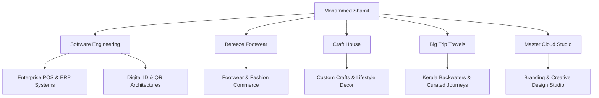

  # 🌟 Mohammed Shamil
  ### **Full-Stack Software Architect • Retail Entrepreneur • Travel Operator**

  

    
    
    
    
  

  

    <i>"Bridging high-performance software engineering with real-world enterprise operations."</i>
  

  ---

## 🌐 Live Experience
Explore the fully interactive, responsive portfolio & business showcase:
👉 **[mohammedshamilbk.github.io/personal-web](https://mohammedshamilbk.github.io/personal-web/)**

---

## 👨‍💻 Executive Summary
Founder & Software Architect building mission-critical business software, scalable ERP architectures, and modern web applications while directing multi-vertical businesses spanning retail footwear, artisan craft stores, and bespoke tourism experiences.

* 📍 **Base**: Kasaragod, Kerala, India
* 💼 **Specialization**: Enterprise Software, POS Systems, Custom ERP, Digital ID Solutions
* 🏢 **Enterprises**: Bereeze Footwear, Craft House, Big Trip Travels, Master Cloud

---

## 🛠️ Technology Stack & Architectures

| Domain | Technologies & Frameworks |
| :--- | :--- |
| **Languages** | `Python`, `JavaScript (ES6+)`, `Java`, `HTML5`, `CSS3`, `SQL` |
| **Backend & Frameworks** | `Flask`, `Python Tkinter GUI`, `Node.js Ecosystem`, `REST APIs` |
| **Frontend & UI/UX** | `Vanilla Modern CSS`, `Glassmorphism`, `Responsive Grid & Flexbox` |
| **Database & Tools** | `SQLite3`, `MySQL`, `Git`, `GitHub Pages`, `JSON Architecture` |

---

## 💼 Ventures & Business Ecosystem

### 1. 💻 Software & Digital Architecture
* **Bereeze Footwear Enterprise POS**: Real-time barcode scanning, multi-tier inventory categorization, GST invoice compliance, and daily sales ledger.
* **Digital ID & Verification**: Automated cryptographic credentials, student records, and QR attendance systems.
* **Master Logo QR Suite**: Custom branded dynamic QR generator for seamless payment and menu integration.

### 2. 👟 Bereeze Footwear
* High-volume retail showroom featuring formal, casual, and premium lifestyle footwear collections.
* Website: [breezefootwear.com](https://breezefootwear.com/) | Instagram: [@breeze_footwears](https://www.instagram.com/breeze_footwears)

### 3. 🎨 Craft House
* Artisan decor, custom handcrafted gifts, and tailored design accessories.
* Phone: `+91 70343 60086` | Instagram: [@crafthousein.ksd](https://www.instagram.com/crafthousein.ksd)

### 4. 🌴 Big Trip Travels
* Curated travel packages across South India & international destinations, specializing in Kerala luxury houseboat stays and eco-tourism.
* Website: [bigtriptravels.com](https://bigtriptravels.com/)

### 5. ⚡ Master Cloud Creative Studio
* Branding, creative media, visual identity, and social media growth engineering.
* Instagram: [@master.cloud_](https://www.instagram.com/master.cloud_)

---

## 📱 Contact & Connectivity

| Channel | Details |
| :--- | :--- |
| 📞 **Personal Mobile** | [`+91 94952 82744`](tel:+919495282744) |
| ✉️ **Direct Email** | `shamilmohammed926@gmail.com` |
| 💼 **LinkedIn** | [mohammed-shamil-b11120321](https://www.linkedin.com/in/mohammed-shamil-b11120321) |
| 🐙 **GitHub** | [@mohammedshamilbk](https://github.com/mohammedshamilbk) |
| 📸 **Personal Instagram** | [@shamil__abdulla](https://www.instagram.com/shamil__abdulla) |
| 🔗 **Linktree** | [linktr.ee/shamilmohammed926](https://linktr.ee/shamilmohammed926) |
| 🏢 **Office Address** | Kallumkottam House, East Bevinje, Thekkil Ferry PO, Kasaragod – 671542, Kerala, INDIA |

---

  © 2026 Mohammed Shamil. Designed with precision & state-of-the-art aesthetics.

