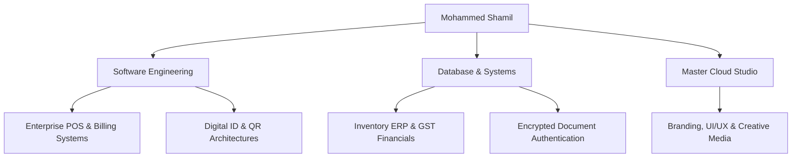

  # 🌟 Mohammed Shamil
  ### **Full-Stack Software Architect • Systems Developer • Creative Director**

  

    
    
    
    
  

  

    <i>"Engineering high-performance software systems and modern digital solutions."</i>
  

  ---

## 🌐 Live Experience
Explore the fully interactive, responsive portfolio & software showcase:
👉 **[mohammedshamilbk.github.io/personal-web](https://mohammedshamilbk.github.io/personal-web/)**

---

## 👨‍💻 Executive Summary
Founder & Software Architect building mission-critical business software, scalable ERP architectures, secure digital identity systems, and modern web applications.

* 📍 **Base**: Kasaragod, Kerala, India
* 💼 **Specialization**: Enterprise POS Systems, Custom ERP, Digital ID Solutions, Database Automation
* ⚡ **Studio**: Master Cloud Creative Media

---

## 🛠️ Technology Stack & Architectures

| Domain | Technologies & Frameworks |
| :--- | :--- |
| **Languages** | `Python`, `JavaScript (ES6+)`, `Java`, `HTML5`, `CSS3`, `SQL` |
| **Backend & Frameworks** | `Flask`, `Python Tkinter GUI`, `Node.js Ecosystem`, `REST APIs` |
| **Frontend & UI/UX** | `Vanilla Modern CSS`, `Glassmorphism`, `Responsive Grid & Flexbox` |
| **Database & Tools** | `SQLite3`, `MySQL`, `Git`, `GitHub Pages`, `JSON Architecture` |

---

## 💼 Core Solutions & Architectures

### 1. 💻 Enterprise POS & Billing System
* High-performance point-of-sale desktop application with rapid barcode scanning, real-time inventory synchronization, GST tax invoice generation, and sales reporting.

### 2. 🛡️ Digital ID & Document Verification Suite
* Secure identity verification engine with SHA-256 document hashing, cryptographic validation, and tamper-proof database storage.

### 3. 📱 Dynamic Branded QR Suite
* Custom QR code generation engine that embeds high-resolution brand logos while preserving 100% error-correction scanning tolerance.

### 4. 📦 Inventory Management ERP
* Automated stock monitoring platform with low-stock alerts, multi-category organization, and sales velocity analytics.

### 5. ⚡ Master Cloud Creative Studio
* Digital UI/UX design, visual storytelling, branding, motion graphics, and creative digital media.
* Instagram: [@master.cloud_](https://www.instagram.com/master.cloud_)

---

## 📱 Contact & Connectivity

| Channel | Details |
| :--- | :--- |
| 📞 **Personal Mobile & WhatsApp** | [`+91 94952 82744`](tel:+919495282744) • [WhatsApp Chat](https://wa.me/919495282744) |
| ✉️ **Direct Email** | `shamilmohammed926@gmail.com` |
| 💼 **LinkedIn** | [mohammed-shamil-b11120321](https://www.linkedin.com/in/mohammed-shamil-b11120321) |
| 🐙 **GitHub** | [@mohammedshamilbk](https://github.com/mohammedshamilbk) |
| 📸 **Personal Instagram** | [@shamil__abdulla](https://www.instagram.com/shamil__abdulla) |
| 🎨 **Master Cloud Instagram** | [@master.cloud_](https://www.instagram.com/master.cloud_) |
| 🔗 **Linktree** | [linktr.ee/shamilmohammed926](https://linktr.ee/shamilmohammed926) |
| 🏢 **Office Address** | Kallumkottam House, East Bevinje, Thekkil Ferry PO, Kasaragod – 671542, Kerala, INDIA |

---

  © 2026 Mohammed Shamil. Designed with precision & state-of-the-art aesthetics.

